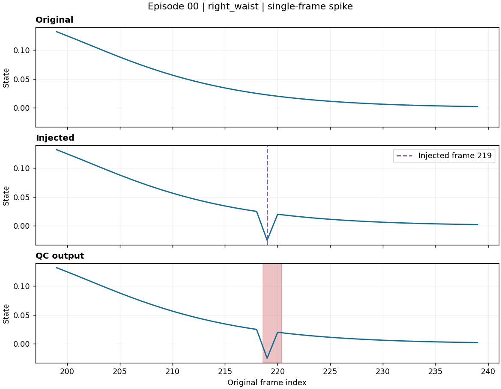
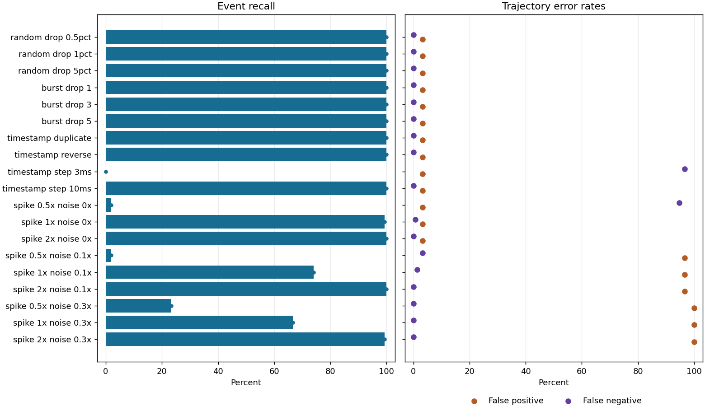

# 机器人轨迹质检与评测

基于公开 ALOHA 双臂仿真轨迹的 Python 离线质检工具。逐条检查丢帧、时间戳异常和关节位置突跳，记录异常发生在哪一帧、哪个通道，并用可复现的故障注入实验衡量误报、漏报和异常定位表现。

## 实测结果

原始数据有 **50 条轨迹、20,000 帧**。按轨迹划分了 20 条校准集和 30 条评测集，以随机种子 42 运行 19 个场景，每场景 150 个注入样本和 150 个配对对照，共计 **2,850 对评测样本**。原始批次 **47/50 条通过规则**，3 条轨迹共触发 7 次突跳告警，原始记录没有人工故障标签。

| 场景 | 命中的注入事件 | 轨迹级误报率 | 说明 |
| --- | ---: | ---: | --- |
| 随机丢帧 0.5%、1%、5% | 3,735/3,735 | 3.3% | 依靠保留的原始帧号定位丢帧区间 |
| 时间戳偏移 3 ms | 0/150 | 3.3% | 偏移低于 5 ms 容差 |
| 时间戳偏移 10 ms | 150/150 | 3.3% | 偏移高于 5 ms 容差 |
| 0.5 倍阈值尖峰，无附加噪声 | 3/150 | 3.3% | 小幅突跳多数漏检 |
| 1 倍阈值尖峰，无附加噪声 | 149/150 | 3.3% | 受该帧原始运动方向和幅度影响 |
| 1 倍阈值尖峰，噪声标准差为 0.1 倍阈值 | 111/150 | 96.7% | 多通道、多帧上任一告警即拦截整条轨迹 |

在最后一个场景中，148/150 条故障轨迹有告警，但只有 111/150 次尖峰被正确定位。这个差异可以用来检查告警是否真的命中故障。未加噪的对照组每场景有 5 次误报，来自同一条原始轨迹在 5 轮中的重复告警。

### 突跳定位示例

第 0 条轨迹在右侧腰关节的第 219 帧注入尖峰。相邻两个差分被触发，检测器将第 219–220 帧的告警合并为一个事件。





可直接查看 [逐轨迹结果](results/quality_summary.csv)、[原始批次告警](results/anomalies.csv)、[19 个场景汇总](results/benchmark_summary.csv) 与 [校准配置](results/run.json)。

## 复现

使用 Python 3.11–3.13。下列命令会下载约 2.6 MB 的 Parquet 并核对 SHA-256，然后生成完整 HTML 报告和结果表。

```bash
git clone https://github.com/osnddwqd-hub/robot-trajectory-qc.git
cd robot-trajectory-qc
python -m pip install -r requirements.txt
python -m robot_qc --download
python -m unittest discover -s tests -v
```

运行后用浏览器打开 `output/report.html`，可以查看所有 50 条轨迹的关节曲线。已下载数据可用 `--input 路径` 指定。可用校准结果单独检查另一批同格式、同采样频率的轨迹。

```bash
python -m robot_qc --input data/new_batch.parquet --thresholds-from output/run.json --out output_batch
```

| 输出 | 内容 |
| --- | --- |
| `quality_summary.csv` | 每条轨迹的是否通过、告警数、丢帧数与异常类型 |
| `anomalies.csv` | 异常区间、通道、观测值、参照值和原因 |
| `benchmark_summary.csv` | 各场景的轨迹级混淆计数以及事件级精确率、召回率 |
| `benchmark_cases.csv`、`benchmark_events.csv` | 每次评测的计数与注入、检测、对照事件明细 |
| `run.json` | 输入哈希、校准和评测轨迹 ID、随机种子及各通道阈值 |

## 方法与评测口径

- **丢帧**　用相邻帧编号的差值定位内部缺口。缺口两侧的时间增量应与跨过的采样周期数相符。若没有可信的帧号或预期起止编号，首尾丢帧和重新编号后的帧缺失需要额外依据。
- **时间戳**　按原始行顺序检查重复、倒序和采样间隔偏差，容差为 5 ms。时间单位为秒。这项规则度量轨迹内部时序，跨相机或跨传感器同步需独立参考时钟。
- **位置突跳**　只检查帧号连续且采样间隔正常的帧对。各通道阈值为校准集相邻状态变化绝对值的第 99.9 百分位乘以 1.25，最小阈值为 1e-6。左右夹爪各用自己的通道阈值。这里用的是数据集中的状态值，阈值用作本批轨迹的经验筛查。
- **实验设计**　随机丢帧和连续丢帧只注入轨迹内部。单关节脉冲幅度为通道阈值的 0.5、1 或 2 倍，噪声是按通道阈值缩放的独立零均值高斯噪声。每次注入用相同背景噪声生成配对对照。不同尖峰幅度和噪声组复用注入关节、位置、方向和底层标准正态样本。评测前检查基准帧编号与时间间隔，再保留基准状态的自然运动作为对照。
- **指标**　轨迹漏报率为未触发任何规则的故障样本占比，轨迹误报率为触发规则的对照样本占比。事件级匹配要求异常类型相同，缺帧区间和时间戳位置精确匹配。单帧尖峰可命中进入或离开该帧的差分，且须命中同一关节。事件一对一匹配。每轮重复使用同一批原始轨迹，评测结论适用于这些仿真轨迹、固定阈值和注入场景。

## 数据来源

[LeRobot ALOHA Sim Transfer Cube Scripted](https://huggingface.co/datasets/lerobot/aloha_sim_transfer_cube_scripted)，Apache-2.0。项目使用固定版本 `c5467ba9059e4c65f27775ced212076980a173fb` 的状态表，原始数据由复现命令下载。
